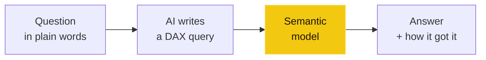

# Conversational BI: an alternative to reports, not a replacement

Most people who open a report don't want the report. They want one number, or the answer to one question, and the report is the place they have to go to find it. That gap is what conversational BI tries to close: you ask "Which region slipped last quarter?" and get the answer, with the measure it used, in a sentence.

I've been exploring this for a while, partly through Copilot and partly by building a small app of my own to see what's going on under the hood. This post is where I've landed so far. Short version: it's a real alternative for a real set of questions. It's not a replacement for Power BI reports, and the teams that treat it as one will end up with two half-working things instead of one good one.

## What "conversational BI" means here

Three steps, whatever the tool:

1. You ask a question in plain words.
2. An AI turns it into a query against your data, usually DAX against a semantic model.
3. You get an answer: a number, a small table or a chart, and ideally a note on how it got there.

The important box is the semantic model in the middle. The AI doesn't invent the numbers. It asks the same model your reports use, through the same measures, so a good answer matches the report to the cent.

## What already exists in the Microsoft stack

You don't have to build anything to try this:

- **Copilot in Power BI** answers data questions against a semantic model. Model authors can shape those answers with **Prep data for AI**: an *AI data schema* (which tables, columns and measures Copilot should use), *verified answers* (a visual you approve as the answer to certain phrases), and *AI instructions* (your business terms and rules in plain text). All three are saved on the semantic model, not on a report.
- **Fabric data agents** answer questions across lakehouses, warehouses, eventhouses and semantic models. For a semantic model, the agent generates DAX from the model's metadata and its Prep for AI settings, and runs it with the asking user's own permissions.

Two things in Microsoft's own documentation are worth reading twice. Copilot's output is nondeterministic: the same question can come back with a different answer. And the guidance for data agents says to review the DAX query behind each response while you test it. Neither of those is a reason to stay away. They are reasons to treat the answers as answers you can check, not answers you have to trust.

## What I built to understand it

Reading docs only gets you so far, so I built a small experiment: a local app I call the Semantic Hub. It finds the models I have open in Power BI Desktop, lets me approve them into a hub, designs a simple dashboard for each one, and puts a chat panel next to it that answers with read-only DAX.

The interesting part wasn't the chat. It was the rules around it, because an AI that can run queries is an AI that can run the wrong query:

- **Read-only.** A query has to start with `EVALUATE` or `DEFINE`, or it never reaches the model.
- **Approved models only.** The AI asks for a model by its id in the hub. It never gets a server name or a connection string, so it can't wander off to something else.
- **Limits.** At most 500 rows come back to the AI, a query gets 30 seconds, and a question gets 10 tool calls.
- **Grounded answers.** The instructions say: answer only from query results, name the measure and filters you used, and say so when the data can't answer.
- **Everything is logged.** Every question, every generated query, the row count and the time it took.

All of that sits in one place in the code that every query has to pass, so the rules don't depend on the AI behaving. The browser never sends DAX either: a filter arrives as a column and values, and the server writes the query itself.

It runs on my PC against Desktop, and right now the chat uses a local model (Qwen3 14B in LM Studio) rather than a cloud one. A switch to Claude exists, but it's experimental and untested. It's an experiment, not a product. The full build log, with what broke, is in the Lab: [Semantic Hub: ask your Power BI model, on your own PC](./post.html?slug=semantic-hub-ask-your-power-bi-model).

What it taught me is the rest of this post.

## Where conversation wins

- **The long tail of questions.** Every report answers the questions someone thought of when building it. "How did gloves do in the West in March compared to last year?" usually isn't one of them.
- **Follow-ups.** "And without the returns?" is a sentence in a chat. In a report it's three slicers, if the report has them.
- **People who never open reports.** A manager who asks one question a month isn't going to learn your navigation. A sentence works for them.
- **Explaining a number.** "Why is this tile high?" with the query shown is often faster than a drill-through path.

## Where reports still win

- **The same numbers for everyone.** A published report shows every viewer the same figures, laid out the same way, every time. A chat answer can come back phrased differently, or built from a different measure, on another day.
- **Things you didn't know to ask.** A good report page shows you the outlier before you think to look for it. A chat only answers what you ask.
- **Monitoring.** Daily KPIs, alerts and subscriptions are a fixed shape on purpose.
- **Reviewed, signed-off content.** When a figure goes to a board or a regulator, someone has checked that exact visual. That's hard to do for an answer that's generated fresh each time.
- **Layout as communication.** Order, grouping and emphasis on a page tell a story. A paragraph of chat doesn't carry that.

So I don't see one replacing the other. Reports are the agreed view. Conversation is the way to ask everything around it.

## It changes what a good model looks like

This is the part I didn't expect. The more of the app I built, the more the quality of an answer seemed to live in the semantic model, not in my code:

- **Descriptions are the documentation the AI reads.** The AI only knows what a measure means from its name and description. The hub flags every measure and column that has no description, because that's where a wrong guess starts.
- **Names matter more than ever.** Two columns called `Name` in different tables, or a measure called `TR_AMT`, confuse a person a little and an AI a lot. Microsoft's guidance for data agents makes the same point with almost the same example.
- **Measures beat raw columns.** If the AI sums a column itself instead of using your `Total Sales` measure, it can quietly skip the logic in that measure. Pointing it at existing measures is what keeps chat answers and report numbers the same.
- **Less is more.** Hiding helper columns and narrowing what the AI can see (the AI data schema in Prep data for AI) removes whole classes of wrong answers.

None of that is new advice for model builders. What's new is the reader: the semantic model is now read by software that takes every name and description literally.

## What I'd do if you want to try it

1. Pick one well-built model, not the messiest one.
2. Add descriptions to the measures people actually ask about, and hide what they shouldn't touch.
3. Try Copilot or a Fabric data agent on it, and write down ten questions with answers you already know.
4. For every answer, look at the query behind it. If it's wrong, fix the model (a name, a description, an instruction), not the question.
5. Keep the report. Add the conversation next to it.

The full build log of the Semantic Hub is in the Lab, there's a [short demo on YouTube](https://youtu.be/hI4K2-Tpefk) (1:25, no sound), and the code is public on [GitHub](https://github.com/goldlayerdata/semantic-hub).

Where do you see it landing in your team: next to the reports, instead of some of them, or not yet?
