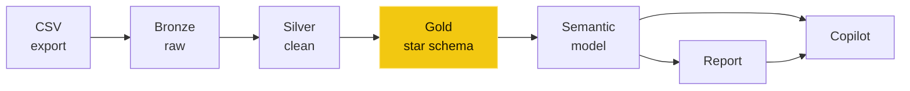
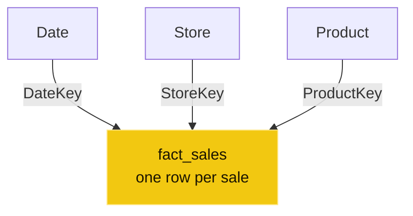
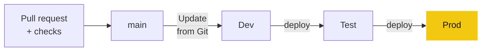

# One row from CSV to a Copilot answer

The [Gold Layer trailer](https://www.youtube.com/watch?v=Ed4PGJp5V5Q) follows one row of sales data across a city in under a minute. The row starts in a CSV file and ends up behind an answer Copilot gives in plain words. A minute is enough to see the route. It isn't enough to see why the route looks the way it does.

This post is the slow version. Same row, same steps, with the reasoning left in.



## The row

It starts as a line in a monthly export, `sales_2026-11.csv`:

```text
date,store,product,amount
2026-11-02,Store 9,P-118,312.00
2026-11-03, store 14 ,P-507,"1,240.50"
2026-11-03,STORE 3,P-022,
2026-11-04,Store 21,P-507,88.10
```

Our row is the second one. It's typical of real exports. The store name has stray spaces and the wrong case, and the amount is text with a thousands separator, so it needs quotes. The line below it has no amount at all. Nothing here is wrong enough to fail a load, and that's the problem: messy data gets through quietly.

## A pipeline picks it up

A Fabric pipeline, `pl_ingest_sales`, runs a **Copy data** activity that lands the file in a lakehouse table. That's the whole job of this step. It moves the data and doesn't fix anything. Keeping ingestion dumb is deliberate: when a number looks wrong later, you want to know whether the source sent it or one of your rules changed it.

## Bronze keeps it raw

The first table, `bronze.sales_raw`, stores the row exactly as it arrived, with every column as a string. `" store 14 "` keeps its spaces and `"1,240.50"` keeps its comma.

The trailer shows the most common Bronze accident too. Someone re-runs the pipeline and the file loads twice, so our row is now in Bronze two times. That's fine, as long as no report reads from Bronze. Bronze is a record of what you received, not something to report from.

## Silver cleans it

`silver.sales` is where the rules live, and in the trailer there are three:

1. **Trim and proper case.** `" store 14 "` becomes `Store 14`.
2. **Set types.** The date becomes a date, and `"1,240.50"` becomes the decimal `1240.50`.
3. **Remove duplicate loads.** Deduplicate on a load key (source file plus line, or a business key), so the re-run's second copy stops here and two genuine, identical sales don't.

Silver is also where you decide what happens to the line with no amount. Drop it, park it in a table for someone to check, or keep it and flag it. Pick one on purpose and write it down. What you shouldn't do is let a type conversion quietly turn it into a zero.

## Gold makes it a fact

In Gold the row becomes part of a star schema. `gold.fact_sales`, here in a Fabric warehouse, holds keys and numbers:

| DateKey | StoreKey | ProductKey | Amount |
|---|---|---|---|
| 20261102 | 9 | 118 | 312.00 |
| 20261103 | 14 | 507 | 1240.50 |
| 20261104 | 21 | 507 | 88.10 |



Each arrow is a one-to-many relationship, and it's the way filters flow: pick a store, and the sales narrow down to that store.

The store names and product details move out to dimension tables, which the keys point to. This shape is what Power BI is built for: filter the dimensions, sum the facts.

Gold holds curated tables, not measures. The measures live one step up, in the semantic model.

## The model counts it once

A **Direct Lake** semantic model sits on top of the Gold tables. Direct Lake loads columns from the Delta tables in OneLake into memory as queries need them. Its refresh only updates metadata (framing), so there's no import refresh copying the data a second time. The first measure is as plain as it gets:

```dax
Sales = SUM ( fact_sales[Amount] )
```

Filter to Store 14 in November 2026 and the total moves from 17,363.70 to 18,604.20. That's our 1,240.50, added once. The re-run's duplicate stopped in Silver, so nobody spends a morning working out why Store 14 had a record month.

This is the point of the layers. Every step closer to the report, the data gets more trustworthy and more shaped, and every problem has an obvious place to be fixed.

## Now it moves a chart

The report reads from the model, not from the tables. The sales chart for November picks up the row like any other value, through the same `Sales` measure that every other visual uses. One definition of "sales", used everywhere.

## Ask it in plain words

Then someone types a question into Copilot:

> Which region slipped last quarter?

The answer in the trailer comes from the Sales model. **West slipped most: −8.4%, Q3 vs Q2**, with North +3.1%, East +1.2% and South −2.0% beside it. Copilot also shows how it got there. Under **How Copilot arrived at this** it lists the fields, filters and the measure it used, and here that's a measure already in the model. This is its definition:

```dax
Sales vs PQ % =
VAR PQ =
    CALCULATE ( [Sales], PREVIOUSQUARTER ( 'Date'[Date] ) )
RETURN
    DIVIDE ( [Sales] - PQ, PQ )
```

Copilot can read the report too. In the report pane it answers from the visuals on the page when they cover the question, with a citation to each visual it used, and goes to the semantic model when they don't.

That's the part people skip when they talk about conversational BI. Copilot is only as good as the model it reads. A clean star schema, clear names and a proper measure for "versus last quarter" are what turn a plain-words question into a number you can defend. `PREVIOUSQUARTER` also needs a real date table: one row per day, full years, no gaps, marked as the date table. Marking it matters here because the relationship uses the integer `DateKey`, not a date column. And the measure is meant for quarter-level visuals: in a month context it compares the month with the whole previous quarter.

And "show me how you got this" isn't decoration. Copilot can also write its own DAX for a one-off question, so check which one you got, and check the answer's working the way you'd check a colleague's.

## Then it ships like code

The last step changes the model itself. Someone wants a new measure, `Sales YoY %`.

Because the model is saved as a Power BI project (PBIP) in Git, the change is a few readable lines in a text file:

```text
tables/_Measures.tmdl   +6
+ measure 'Sales YoY %' = …
```

From there it's the same flow as any code change:



1. **Commit** (`a3f9c2e add Sales YoY %`) and open a **pull request** (`PR #42 → main`).
2. **Checks run on the pull request**: Tabular Editor's Best Practice Analyzer for the model rules and PBI Inspector for the report rules. Both are community tools, and both catch the kind of mistake that's easy to miss by eye.
3. **Merge, then deploy in stages.** Merging doesn't deploy anything by itself:
   - **Dev** is updated from Git (**Update all**, or the Update From Git API).
   - **Test** gets the change from a deployment pipeline.
   - **Prod** gets it from the same pipeline, once Test looks right.

   Deployment rules point each stage's model at that stage's warehouse. Tests that need data, such as checking the new measure's numbers, run after a deploy, not in the pull request.

Nobody edits the production model by hand, and every change has a diff, a reviewer and a way back.

## Bronze. Silver. Gold.

That's the whole trip. Ingest without fixing, keep the raw copy, clean in one place, shape for reporting, define the logic once in the model, and ship changes like code. The answers at the end, whether they come from a chart or from Copilot, are only as good as the layers underneath.

The trailer covers all of it in under a minute. The posts here go through it one step at a time.
