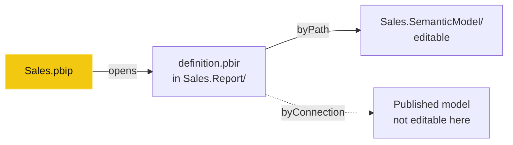
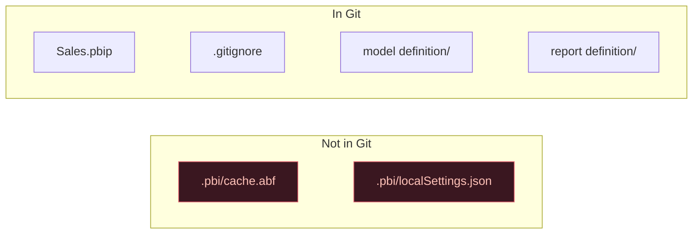
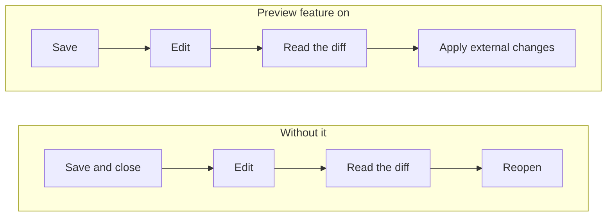

# PBIP explained: the Power BI project folder, file by file

Save a report as a Power BI project (PBIP) and the single `.pbix` turns into a folder of plain text files. The first time I did it, I didn't know which files mattered. Most of them don't, at first. A handful do.

The short above shows the one file that must never leave your machine. This post walks the whole folder, one file at a time.

## The tree

```text
Sales/
├ Sales.pbip                  just a pointer. Open this.
├ .gitignore                  keeps cache & personal files out
├ Sales.SemanticModel/        the model
│  ├ definition.pbism
│  ├ definition/              the model itself, in TMDL
│  │  ├ model.tmdl
│  │  ├ relationships.tmdl
│  │  └ tables/<Table>.tmdl   one file per table
│  └ .pbi/cache.abf           a copy of your DATA. Never commit.
└ Sales.Report/               the report
   ├ definition.pbir          which model it uses
   └ definition/pages/…       the report, page by page
```

A real project has a few more files than this. These are the ones you'll touch, or must never touch.

## The two files at the top

**`Sales.pbip`** is just a pointer. It names the report folder, and opening it opens the report and, through the report, its model. Double-click it to start working.

It's also optional. Fabric Git integration doesn't create one. If it's missing, open `definition.pbir` in the report folder instead. Same result.

**`.gitignore`** is written by Power BI Desktop the first time you save, unless the folder or repo already has one. It holds two lines:

```text
**/.pbi/localSettings.json
**/.pbi/cache.abf
```

The first is your personal settings for this machine. The second is your data. Neither belongs in Git. Keep both lines.

## The model: `Sales.SemanticModel/`

**`definition.pbism`** holds model-level settings and a format version. A version of 4.0 or higher means the model can be stored as TMDL.

**`definition/`** is the model itself, written in TMDL (Tabular Model Definition Language). TMDL is built to be read by people, and it splits the model into files:

- **`model.tmdl`**: model-wide settings, such as culture, plus references to the tables.
- **`relationships.tmdl`**: every relationship, in one file.
- **`tables/<Table>.tmdl`**: one file per table. Columns, measures, hierarchies, and the Power Query (M) that loads the table.

One file per table is the part that matters most. Change a measure in `Sales` and only `Sales.tmdl` changes.

**`.pbi/cache.abf`** is a copy of the model *with its data*, as it was when you last edited it. It's the only file in the project that holds the imported data, and it can be large. Never commit it.

You don't need it to work. Clone a project without `cache.abf` and Desktop opens the full model with no data. Refresh, and the data comes back from the source.

## The report: `Sales.Report/`

**`definition.pbir`** says which model the report uses. It points one of two ways:

- **`byPath`**: a relative path to a model folder, like `../Sales.SemanticModel`. Desktop opens that model for full editing.
- **`byConnection`**: a connection to a model already published to a Fabric workspace. Desktop doesn't open that model for editing. A thin report like this has no `.SemanticModel` folder of its own.



**`definition/`** is the report in PBIR, the enhanced report format. Every page gets a folder with a `page.json`. Every visual on that page gets a folder with a `visual.json`: its type, position, the fields it queries and its formatting. Bookmarks get their own files too. Change one visual and only one file changes.

## Why plain text matters

A `.pbix` is a single binary file. Git can store it, but it can't show you what changed inside it. A PBIP folder is text, so three things open up.

**Git diffs.** Change a measure and the pull request shows exactly which lines moved. On the left, `main`; on the right, your branch:

<div class="compare">
<div>
<p class="compare-label">main · before</p>

```diff
 table Sales
 
 	measure 'Sales Amount' =
-			SUM ( Sales[Amount] )
-		formatString: #,0
```

</div>
<div>
<p class="compare-label">your branch · after</p>

```diff
 table Sales
 
 	measure 'Sales Amount' =
+			SUM ( Sales[Net Amount] )
+		formatString: #,0.00
```

</div>
</div>

Two lines changed in one table file, `Sales.tmdl`, and nothing else. That's what a reviewer reads.

**Code review.** Once a change is a diff, a colleague can read it in a pull request before it reaches anyone's report. Build checks can run on it too.

**AI agents.** An agent can open `Sales.tmdl` or a `visual.json`, change it, and save it, like any other code file. That's useful. It also means the agent can change files you didn't expect. Which is why the rules below exist.

## The rules that bite

**1. Never commit `cache.abf` or `localSettings.json`.** That's what the `.gitignore` is for. If you build your own `.gitignore`, add both lines yourself.



**2. Report files can still hold data values.** `cache.abf` is the only file with the imported data, but it isn't the only file with values *from* the data. Filter a visual to `Company = 'Contoso'` and `'Contoso'` is saved in its `visual.json`. Slicer selections and bookmarks work the same way. Check before you hand a project to a tool or push it somewhere public.

**3. Save before outside edits.** Desktop doesn't write its latest changes to disk until you click Save. Save first, then let an editor or agent touch the files. Recent Desktop releases (August 2026 and later) can notice the files changing and offer **Apply external changes**. It's still a preview feature, so turn on *Detect and reload external PBIP changes* in the preview settings first. Applying reloads from disk and discards anything you hadn't saved. Without that feature, close the project while the files are edited and reopen it after.



**4. Validate PBIR edits against the schema.** Every PBIR file starts with a `$schema` link. VS Code checks the file against it as you edit, and an agent can run the same check. A file that breaks its schema stops Desktop loading the report. The error names the file, but it's quicker to catch it before Desktop does.

**5. Review the diff, not the summary.** An agent will tell you it "added one measure". The diff tells you what it actually did. One new measure is a few lines in one table file. A "small formatting tweak" that touches forty `visual.json` files deserves a closer look.

## The full map

This post covers the files in the short. A real project has more: DAX query tabs, diagram layouts, themes, a mobile layout, and a few files that aren't supported for outside editing at all. The next post is the full field guide: every one of those files, with which ones an agent can safely edit and which ones it should leave alone.
