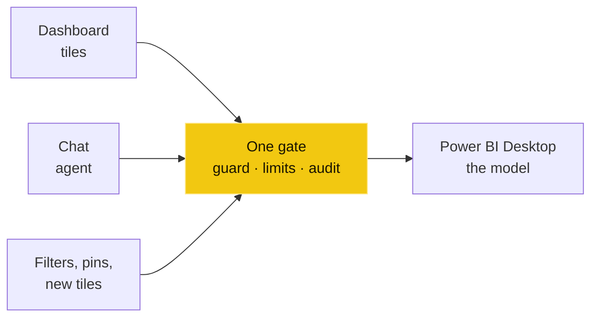

# Semantic Hub: ask your Power BI model, on your own PC

I wanted to know what conversational BI looks like when you build it yourself: no Copilot licence, no tenant, nothing leaving the PC. So I built a small app, with Claude writing the code and me directing and testing. It's called the Semantic Hub.

This is a Lab entry, so it's a log. The app is a finished proof of concept: it works on my machine, it isn't a product, and some of the best lessons came from things that broke. The code is public on [GitHub](https://github.com/goldlayerdata/semantic-hub). The bigger picture, where this fits next to Power BI reports, is in [Conversational BI: an alternative to reports, not a replacement](./post.html?slug=conversational-bi-next-to-reports).

Here's a real run, cut down to a minute and a half, with the waits sped up and the real times shown on screen:

[Watch the demo on YouTube (1:25, no sound)](https://youtu.be/hI4K2-Tpefk)

The screenshots below are from the same run, on a sample model built on Contoso data.

## What it does

1. **Hub.** It finds the `.pbix` files open in Power BI Desktop. You add one, and it reads the model's schema: tables, columns, measures, descriptions and relationships.
2. **Dashboards.** An AI designs a dashboard for the model: KPIs, trends, breakdowns. You can filter it and click any number to see the measure and the query behind it.
3. **Your layout.** You stay in control of the result. Ask for a new tile in plain words and you get a preview first, with nothing saved until you add it. Drag, resize or remove any tile, and undo is one click.
4. **Ask AI.** A chat sits beside the dashboard. It answers by writing DAX queries, shows its steps while it works, draws the result as a chart, and lets you pin an answer to the dashboard.
5. **Audit.** Every query the app runs is logged: who asked, the DAX, the rows, the time, and whether it was blocked.

## The idea: the AI writes queries, it never supplies numbers

The whole design hangs on one sentence: the semantic model is the source of truth, and the AI is only a query writer.

- A dashboard isn't HTML or a picture the AI made. It's a small spec: a list of tiles, each holding a DAX expression. The app runs every tile live.
- A chat answer isn't the AI remembering something. The AI can call three tools (list the models, read a schema, run a read-only DAX query) and has to answer from what the queries return.

## The rules sit in code, not in the prompt

An AI that can run queries can run the wrong one, and asking it nicely in a prompt isn't a control. So everything goes through one function, and that function enforces the rules:

- **Read-only.** A query must start with `EVALUATE` or `DEFINE` once comments are stripped. Anything else is rejected and logged.
- **Registered models only.** The AI asks for a model by its id in the hub. It never sees a connection string or a port.
- **Limits.** 500 rows per query (200 for a tile), 30 seconds, 10 tool calls per question. Past the limit, the AI loses its tools and has to answer with what it has.
- **Audit.** Every query is logged, including the blocked ones.

Because dashboards, filters, pins and chat all use that same gate, a new feature gets the rules for free.

One more rule turned out to matter: **the browser never sends DAX.** Filters arrive as a column name and values, and the server turns them into typed DAX itself. Pinning a chat answer sends only an id, and the server looks up the query it already ran. So there's no way to paste a query in from the outside.

## It runs on a local model

By default the AI is Qwen3 14B running in LM Studio on the same PC. Schema, questions, queries and results only travel between the app, Power BI Desktop and LM Studio, all on `localhost`.

What that looks like on my machine (a 12 GB GPU), timed in one recorded run:

- Designing the dashboard took **43 seconds**.
- A question took **26 to 57 seconds**.
- A new tile took **35 to 75 seconds**. The slow one needed a repair round.
- The UI shows each step as it happens (understanding, running the query, reading the results, writing), so the wait reads as work, not as a hang.

The supported setup is the local model. There is also an experimental switch to Claude, with the same tools and rules, but it's untested, and with it the schema and query results would leave the PC.

The idea behind all of this is a setup that can run fully on-premises: a .NET app, a local model and the semantic model, with nothing in the cloud. So far it has only run on my own PC.

## What broke

- **A test wiped my dashboard.** A layout save that left tiles out deleted them. Now a save never deletes by omission: tiles go only when they're listed as removed, and every save keeps a copy of the previous version. I got the tiles back from the audit log, which is a nice argument for having one.
- **Empty answers.** LM Studio loads models with an 8k context by default. The schema alone is 5 to 8 thousand tokens, so answers came back empty or cut off. It needs 16k, and the app now warns when the model is loaded too small.
- **A minute per answer.** Qwen3's "thinking" mode made every answer slow. Switching it off brought it back to seconds.
- **A small model writes imperfect DAX.** So the engine is the judge: every tile the AI designs is run against the model. A failing tile gets one repair round with the real error message, and if it fails again it's dropped and listed.
- **"Last year" that didn't exist.** On a model with historical data, the AI assumed last year had rows. Adding a short data profile (row counts and the date range of each fact table) to what the AI reads fixed that.

## What I learned about models, not code

The answers got better when the model got clearer, more than when the code got smarter. The hub card shows **description coverage** for each model for that reason: the AI only knows what a measure means from its name and description. Explicit measures like `[Revenue]` also beat letting the AI add up a column on its own.

## Where it could go next

The proof of concept is done. If I take it further:

- Run it on a server inside a network instead of my own PC. That's the on-premises idea, and it's untested.
- Models in the Power BI service, signed in as yourself so row-level security still applies.
- A set of questions with known answers, to check quality after every change.

## What it taught us about AI

The AI is a query writer, not a source of numbers. What makes it safe is one gate in code that every query has to pass, and what makes it good is the model's own names and descriptions.
